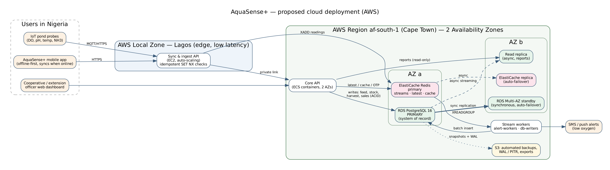

# Portfolio 5 — Distributed and Cloud Database Exercise

A real 4-node PostgreSQL 16 cluster was built on one machine to demonstrate **replication**,
**sharding**, **availability/consistency trade-offs** and **failover** with AquaSense+ data, followed
by a cloud deployment design.

| Node | Port | Role |
|---|---|---|
| primary | 5432 | System of record (Portfolios 1–3) and shard coordinator |
| replica1 | 5433 | Streaming replica, hot standby (read-only) |
| shard1 | 5434 | Holds sensor readings for farms with `hash(farm_id) % 2 = 0` |
| shard2 | 5435 | Holds sensor readings for farms with `hash(farm_id) % 2 = 1` |

## Files

| File | Purpose |
|---|---|
| `01_setup_cluster.sh` | Replication role + slot, `pg_basebackup -R`, start replica and two shard nodes |
| `02_replication_demo.py` | R1–R6: status, lag, read-only replica, read scaling, async vs sync, sync with replica down |
| `03_sharding_setup.sql` | `postgres_fdw` servers + hash-partitioned table whose partitions live on the shard nodes; loads 1,033,625 readings |
| `04_sharding_demo.sh` | S1–S6: distribution, skew, pruning, scatter-gather, write routing, shard failure |
| `05_failover_demo.sh` | Primary crash → promote replica; RTO/RPO; lab restore |
| `cloud_architecture.png` / `.dot` | Proposed AWS deployment |
| `evidence/*.txt` | Output of every script above |

## Part A — Replication (`evidence/replication_demo_output.txt`)

| Test | Result | Meaning |
|---|---|---|
| R1 Status | `replica1 · streaming · async`, 0 bytes behind; physical slot `replica1_slot` active | The slot keeps WAL on the primary until the replica has received it, so a disconnected replica can catch up |
| R2 Lag (30 trials) | Median **0.97 ms**, max 1.77 ms until a new row was visible on the replica | **Eventual consistency**: for ~1 ms a read from the replica can miss a write just made on the primary |
| R3 Write to replica | `ERROR 25006: cannot execute INSERT in a read-only transaction` | Replicas scale reads only |
| R4 Read scaling | Cooperative revenue report (Lagos ₦1.89 bn in 2026) ran on the replica in 8.4 ms | Heavy reports can be moved off the primary |
| R5 Async vs sync | Commit median **0.415 ms async → 0.805 ms** with `synchronous_commit = remote_apply` (1.9×) | Stronger consistency costs latency — and that is with both nodes on one machine; across data centres every commit also pays the network round trip |
| R5 Read-your-writes | With `remote_apply`, a row was visible on the replica immediately after COMMIT | Synchronous replication gives read-your-writes on replicas |
| R6 Replica down while sync | Primary `INSERT` **blocked** (`wait_event = SyncRep`) until the operator switched back to async; it then committed after 5.0 s. The restarted replica caught up from its slot | **CAP in practice**: during a partition the system chose consistency and lost write availability |

## Part B — Sharding (`evidence/sharding_demo_output.txt`)

**Shard key: `farm_id`, hash-partitioned.** Every screen a farmer uses is about their own farm, so
co-locating all of a farm's readings on one node makes the commonest query single-shard. The check
"farms on both shards" returned **0**.

| Test | Result |
|---|---|
| S1 Distribution | shard1: 581,404 readings / 103 farms / 77 MB; shard2: 452,221 / 77 farms / 60 MB |
| S2 Why hash, not region | A South/North split would put **76.5%** of readings on one node (137 vs 43 farms). Hash gave 56/44. Two buckets over 180 farms is still uneven — with more shards, or many virtual buckets per node (as Citus/Redis Cluster do), it evens out and shards can be rebalanced |
| S3 Single-farm query | Plan has one `Foreign Scan on wqr_dist_p0` — **partition pruning** sent it only to shard1, with `WHERE farm_id = 64 AND unit_id = 316 ORDER BY …` pushed into the Remote SQL. 5.8 ms vs 0.33 ms locally: a remote hop costs latency |
| S4 Cross-shard aggregate | Without pushdown: 255 ms (1M raw rows shipped to the coordinator). With `enable_partitionwise_aggregate`: **63 ms** — plan shows two `Async Foreign Scan`s running in parallel, each executing `GROUP BY` on its own shard. Single-node table: 73 ms |
| S5 Write routing | An insert for farm 64 landed on shard1 only |
| S6 Shard failure | With shard2 stopped, farm 1 (shard1) still worked; farm 3 (shard2) and the cross-shard report failed with `could not connect to server "shard2"`. After restart all 1,033,625 rows were back |

**Lessons.** Sharding gives write and storage scale-out and **fault isolation** (half the farms
kept working), but (1) single-shard queries become slower than local ones, (2) cross-shard queries
are only competitive when aggregation is pushed down, (3) one dead shard breaks every cross-shard
report — so in production each shard needs its own replica (Part A), and (4) cross-shard
transactions would need two-phase commit, which is why the shard key keeps each farm's data together.

## Part C — Failover (`evidence/failover_demo_output.txt`)

| Step | Result |
|---|---|
| Crash | Primary killed with `pg_ctl -m immediate` (no clean shutdown) |
| During outage | Replica kept serving reads (180 farms, last record visible) |
| Promotion | `pg_promote()` → `in_recovery = false`, **timeline 1 → 2** |
| **RTO** | **296 ms** from crash to promotion (scripted; real systems add failure-detection time, e.g. Patroni's ~30 s leader TTL). First write accepted 1.4 s after the crash (includes a deliberate 1 s pause and a checkpoint) |
| **RPO** | **0** — the last write before the crash was on the new primary, because lag was ~1 ms. With async replication, any commit inside that window would be lost |
| Observation | The first ID on the new primary jumped from 633 to 661: sequences are WAL-logged 32 values ahead, so a failover leaves gaps (again — never treat IDs as gap-free) |
| Split-brain | The old primary must be fenced and rejoined as a replica (`pg_rewind` / fresh `pg_basebackup`), never just restarted as a writer |

## Part D — Cloud deployment design



| Layer | Choice | Reason (linked to evidence above) |
|---|---|---|
| Edge | **AWS Local Zone, Lagos** (general availability Jan 2023, parent region af-south-1) for the sync/ingest API | Farmers are on mobile networks; a nearby endpoint shortens upload time for offline sync and sensor data |
| System of record | **Amazon RDS for PostgreSQL**, **Multi-AZ** in af-south-1 (Cape Town) | Synchronous standby in a second AZ = R5's strong durability, with automatic failover (Part C) managed by AWS |
| Reporting | RDS **read replica** (async) | Cooperative dashboards tolerate ~ms–s staleness (R2, R4) |
| Real-time | **ElastiCache (Redis)** primary + replica, automatic failover | Streams, alerts, latest readings, OTP (Portfolio 4) |
| Backups | Automated snapshots + continuous WAL archiving to S3 → **point-in-time recovery** | Protects against human error, which replication copies faithfully |
| Scaling path | 1) bigger instance + read replicas; 2) time partitioning of `water_quality_reading`; 3) shard by `farm_id` (e.g. Citus) only when write volume or size outgrows one primary | Part B showed sharding has real costs; at today's volume (~1M readings/year) one primary is enough |

**Consistency choices per data type (PACELC view)**

| Data | Choice | Why |
|---|---|---|
| Feed stock, harvests, sales, payments | **Consistency** — primary only, synchronous standby | Money and stock must never be wrong or double-spent (Portfolio 3) |
| Farm and cooperative reports | **Latency** — async replica | A dashboard a second out of date is acceptable |
| Sensor readings and alerts | **Availability** — Redis stream, async | An alert must still fire if the main database is failing over; duplicates are filtered |

**Data protection (Nigeria).** AquaSense+ stores personal data (names, phone numbers, farm
locations). The Nigeria Data Protection Act 2023 allows personal data to be transferred outside
Nigeria only where adequate protection or approved safeguards are in place, so hosting the database in
South Africa must be covered by a documented transfer basis and the processor agreement with the
cloud provider. Mitigations: encryption at rest (KMS) and in transit (TLS), least-privilege roles
(the `replicator` role can only replicate), and keeping the option of Lagos-based hosting for the
primary if regulation or customers require it.

## How to reproduce
```bash
./01_setup_cluster.sh
python3 02_replication_demo.py
psql -p 5432 -d aquasense -f 03_sharding_setup.sql
./04_sharding_demo.sh
./05_failover_demo.sh
```
(The scripts use local paths and trust authentication for a lab; passwords and `pg_hba.conf` rules
would be tightened for any real deployment.)
